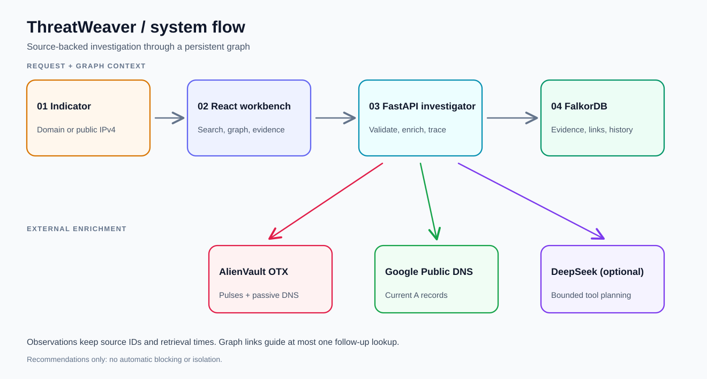

# ThreatWeaver

ThreatWeaver is a local security investigation workbench for a **domain or public IPv4 address**. It collects live external context, saves source-backed observations in FalkorDB, follows bounded graph links, and produces a report that separates observations, inferences, and unknowns.

An OTX pulse mention or DNS connection is a lead for investigation. It does **not** establish that an IP is malicious or that a machine is compromised. ThreatWeaver recommends next steps; it does not block traffic or isolate systems.

## System flow

The website opens with a product overview at `/`, a searchable field guide at `/docs`, and the investigation workbench at `/investigate`. The guide covers setup, architecture, nodes and arrows, two-hop paths, evidence provenance, report interpretation, planner bounds, API routes, and troubleshooting.

The on-site diagrams include downloadable Excalidraw scenes and matching SVG previews in `frontend/public/diagrams`. Regenerate these together with `python docs/generate_web_diagrams.py`. Download a scene from the documentation and open it in Excalidraw to edit it for a presentation. For static hosting, configure an SPA fallback to `index.html` so `/docs` and `/investigate` can be opened directly; Vite's development and preview servers already provide this fallback.



The diagram is also available as an [editable Excalidraw scene](docs/system-flow.excalidraw). Open that file in [Excalidraw](https://excalidraw.com/) to rearrange or export it. The SVG above is the README preview; both files use the same layout, with separate connector lanes and no crossing lines.

1. The React workbench sends a bare domain or public IPv4 address to FastAPI.
2. FastAPI validates the input. It requests OTX general intelligence and passive DNS. For domains, it also requests current A records from Google Public DNS. OTX passive DNS and current DNS are stored as different observation types.
3. FastAPI writes indicators, observations, source references, and investigation history to FalkorDB. It reads up to two hops of sourced links and may select one current observed neighbor for a follow-up OTX lookup.
4. The workbench displays the report, graph, evidence inspector, source warnings, and saved investigations. The optional DeepSeek planner can call bounded read tools and one observed-neighbor lookup; its calls are audited. The evidence-backed report remains authoritative.

## Run locally

You need Docker Desktop with Compose, Python 3.11–3.14, and Node.js 20+. An [AlienVault OTX key](https://otx.alienvault.com/) enables live threat intelligence. A DeepSeek API key is optional for the tool planner. Local FalkorDB requires no cloud account.

Run these commands from the repository root in PowerShell:

```powershell
if (-not (Test-Path .env)) { Copy-Item .env.example .env }
notepad .env
```

Set `OTX_API_KEY` in `.env`. Set `DEEPSEEK_API_KEY` only if you want the optional planner. Keep both keys private; `.env` is ignored by Git.

Start FalkorDB after Docker Desktop is running:

```powershell
docker compose up -d
docker compose ps
```

Create a Python virtual environment and start the API:

```powershell
python -m venv .venv
.\.venv\Scripts\python.exe -m pip install -r backend\requirements.txt
.\.venv\Scripts\python.exe -m uvicorn backend.app.main:app --reload --port 8000
```

Leave that terminal open. In another PowerShell terminal, run:

```powershell
cd D:\harsh\Threatweaver\frontend
npm.cmd install
npm.cmd run dev
```

Open the [ThreatWeaver workbench](http://localhost:5173). The [API health page](http://localhost:8000/api/health) should show `"graph": "ready"`; it also reports whether the OTX and DeepSeek keys are configured without revealing them. Use a bare domain such as `example.com` or a public IPv4 address such as `8.8.8.8`—no `https://` or path.

| Local address | Purpose |
| --- | --- |
| `http://localhost:5173` | ThreatWeaver website |
| `http://localhost:8000/api/health` | API and dependency status |
| `http://localhost:3000` | FalkorDB Browser |
| `localhost:6379` | FalkorDB database connection; not a web page |

Compose binds FalkorDB to localhost. Its named volume is mounted at the database's actual data directory, with append-only persistence enabled. Saved data survives container recreation. `docker compose down -v` removes the volume and its graph data.

## See the same graph in FalkorDB Browser

Run a domain investigation in ThreatWeaver. Open `http://localhost:3000`—or click **Open in FalkorDB** on the graph card—and select the `threatweaver` graph. This is the same database used by the website.

To inspect `example.com` links, run this read-only query in FalkorDB Browser:

```cypher
MATCH (d:Indicator {key: 'domain:example.com'})-[r:OBSERVED_LINK]-(ip:Indicator)
RETURN d.key, ip.key, r.predicate, r.observation_id
LIMIT 20
```

`current_dns_a` means a current Google Public DNS A answer. `passive_dns` means an OTX passive DNS association. Select an edge in ThreatWeaver to inspect the underlying observation ID, source URL, and timestamps. Current resolution can change, and shared infrastructure does not prove common ownership or malicious intent.

## Data model and limits

The workbench includes quick-fill example indicators, evidence search, and an exact source-ID filter. Download the current investigation as Markdown for review or JSON for its complete report, graph, evidence, and tool audit. Markdown exports retain source references, timestamps, and uncertainty statements.

Recommended actions have a progress checklist saved locally in this browser for each indicator. Reopening an indicator restores checks for matching action text; checklist progress is not shared with other browsers or included in exports. The evidence inspector supports keyboard navigation and closes with Escape.

The graph has `Indicator`, `Observation`, `Evidence`, and `Investigation` nodes. `HAS_OBSERVATION` and `SUPPORTED_BY` retain provenance; `POINTS_TO` and `OBSERVED_LINK` connect sourced indicators; `HAS_INVESTIGATION` retains a run. Repeated fetches reuse stable observation and evidence IDs and update the last fetch time.

Queries use fixed Cypher templates with parameters. The current limits are: two graph hops, 50 paths or evidence records per query, 12 OTX passive DNS entries, five current DNS A answers, one follow-up OTX lookup, and 20 recent investigations. The optional planner allows at most three model iterations, three tool calls per iteration, and one observed-neighbor lookup. It cannot issue arbitrary Cypher or production blocking actions.

Useful API routes:

| Route | Purpose |
| --- | --- |
| `POST /api/investigations` | Run an investigation; accepts `{"indicator":"example.com","expand":true,"use_agent":false}` |
| `GET /api/investigations?limit=10` | List saved runs |
| `GET /api/investigations/{uuid}` | Reopen a saved run and tool audit |
| `GET /api/tools/trace_paths?indicator=example.com&depth=2&limit=30` | Inspect bounded graph paths |
| `GET /api/tools/get_evidence?indicator=example.com&limit=30` | Inspect source references |
| `GET /api/observations/{id}` | Inspect evidence behind a graph edge |

## Troubleshooting

| Symptom | Check |
| --- | --- |
| FalkorDB Browser does not open | Use `http://localhost:3000`, not port `6379`. Check `docker compose ps`. |
| API health reports `graph: unavailable` | Start Docker Desktop, run `docker compose up -d`, then check `docker compose logs falkordb`. |
| Investigation returns `422` | Enter a bare domain or public IPv4 address. Local/private IPs and full URLs are unsupported. |
| OTX result is partial | OTX passive DNS may time out. General OTX findings and current DNS links are retained when available; the warning names the failed source. |
| OTX or DeepSeek says key missing | Add the key to `.env` and restart the backend. |

## Verify and demo

```powershell
.\.venv\Scripts\python.exe -m pytest backend\tests -q
cd frontend
npm.cmd run build
```

The tests use mocked source responses and check validation, partial OTX results, current DNS normalization, graph bounds, and evidence language. For a live walkthrough, follow [the demo script](docs/DEMO.md). This repository has no deployed service or recorded demo video.
