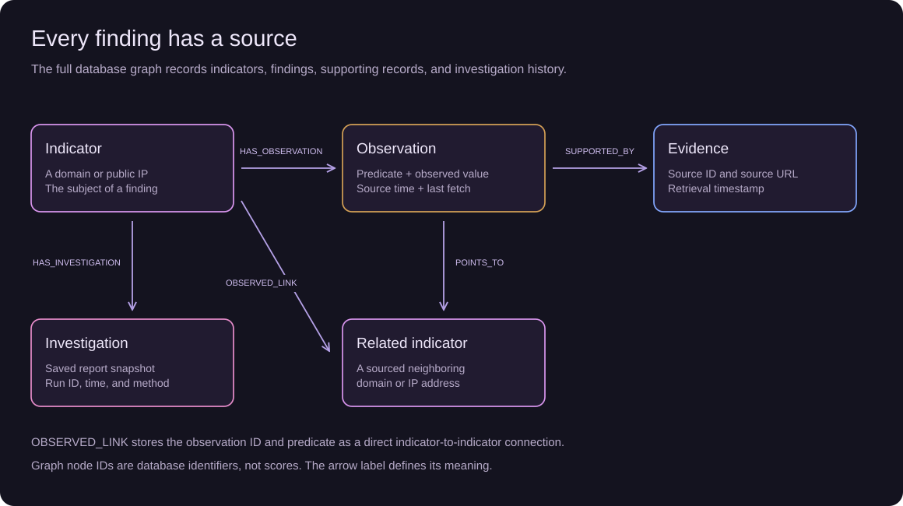
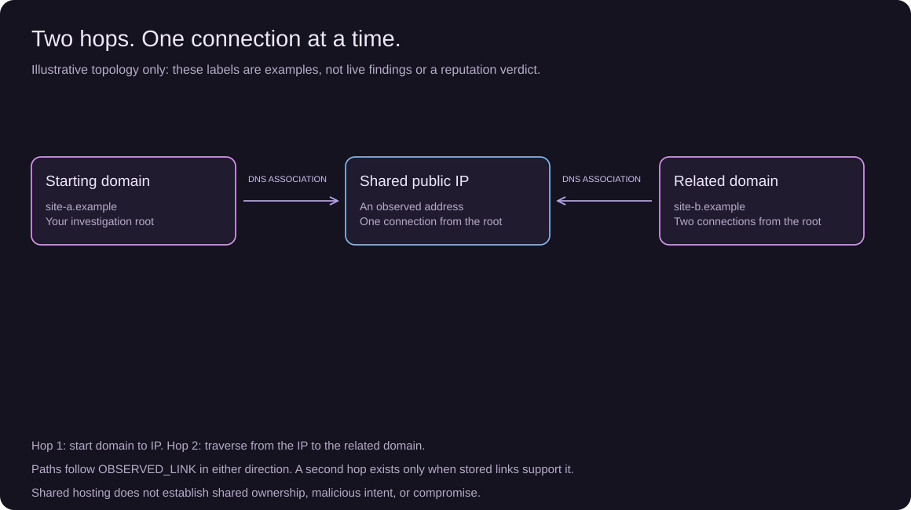

# Graph data model

ThreatWeaver uses the `threatweaver` FalkorDB graph by default. The graph is part of the investigation: its stored, sourced relationships are queried to select eligible follow-up indicators and assemble report context. It is not only a visualization.

Implementation: [`backend/app/graph.py`](../backend/app/graph.py). Source normalization and investigation orchestration: [`backend/app/investigation.py`](../backend/app/investigation.py).

## Nodes and properties

| Label | Identity | Properties | Meaning |
| --- | --- | --- | --- |
| `Indicator` | `key` | `kind`, `value` | `kind` is `domain` or `IPv4`; the key combines kind and normalized value. |
| `Observation` | `id` | `predicate`, `object`, `source_time`, `last_fetched_at` | A source-backed finding about an indicator. Objects are stored as strings, limited to 500 characters. |
| `Evidence` | `id` | `source_id`, `url`, `last_fetched_at` | The source record supporting the finding. It is a reference, not an archived copy of the external webpage. |
| `Investigation` | UUID `id` | `indicator`, `created_at`, `status`, `method`, `snapshot` | A saved run. `snapshot` is JSON containing the report, graph, evidence, and optional tool audit. |

Indexes are created on `Indicator.key`, `Observation.id`, `Evidence.id`, and `Investigation.id`. These are lookup indexes, not database uniqueness constraints; application writes use `MERGE` for reusable entities.

Example indicator keys: `domain:tripcraft-blue.vercel.app`, `domain:example.com`, `IPv4:8.8.8.8`. Examples identify inputs, not reputation verdicts.

## Relationships

| Relationship | Direction | Properties | Meaning |
| --- | --- | --- | --- |
| `HAS_OBSERVATION` | Indicator → Observation | None | This finding concerns the indicator. |
| `SUPPORTED_BY` | Observation → Evidence | None | This source supports the finding. |
| `POINTS_TO` | Observation → Indicator | None | The finding identifies a neighboring indicator. Only created for relational observations. |
| `OBSERVED_LINK` | Indicator → Indicator | `observation_id`, `predicate` | Direct indicator connection, retaining a pointer to the finding that supports it. |
| `HAS_INVESTIGATION` | Indicator → Investigation | None | This run investigated the indicator. |



[Edit the Excalidraw scene](../frontend/public/diagrams/evidence-model.excalidraw).

## Observation types

| Predicate | Source | Object / interpretation |
| --- | --- | --- |
| `otx_pulse_count` | OTX general intelligence | Reported pulse count as a string; zero is not proof of safety. |
| `otx_pulse` | OTX general intelligence | A returned pulse name with its source reference; up to five names are retained. |
| `passive_dns` | OTX passive DNS | A related indicator key. Historical context; a supplied last-seen time is stored as `source_time`. |
| `current_dns_a` | Google Public DNS | A resolved public IPv4 indicator key from the current A lookup. |

Pulse records do not create indicator-to-indicator graph edges. DNS observations with a valid neighbor create both `POINTS_TO` and `OBSERVED_LINK`.

## Identity and deduplication

`Indicator.key` is produced by input normalization. The API accepts a bare domain or global public IPv4 address and rejects full URLs, private/local IPs, and IPv6 inputs.

Observation IDs are the first 24 hexadecimal characters of SHA-256 over:

```text
subject.key | predicate | object_value | source_id
```

Evidence IDs use the first 24 hexadecimal characters of SHA-256 over:

```text
source_id | subject.key | predicate | object_value
```

The `|` characters above are literal separators, with no surrounding spaces in the implementation. Matching repeat fetches reuse these identities and relationships and update the fetch time. A changed value can create a new observation. Each saved investigation gets a new UUID, even when the indicator is unchanged.

## Time and history

`source_time` records available source event time; it can be empty when the source does not supply one. For current DNS observations, the collection time is used. `last_fetched_at` says when the record was retrieved, not necessarily when the underlying association existed.

The persistent graph accumulates observations and does not expire old DNS relationships automatically. It should not be interpreted as a list of only currently active associations. Investigation snapshots retain the result assembled for a run; reopening history reads that snapshot rather than rerunning live sources. New snapshots are limited to 100,000 characters.

## Graph paths and investigation decisions

The workbench traverses only `OBSERVED_LINK` when building indicator paths. One hop crosses one such connection; two hops cross two. Traversal is undirected, so it can follow associations regardless of their stored direction. `Indicator → Observation → Evidence` is a provenance chain and is not a two-hop indicator path.



A deterministic follow-up is selected by intersecting graph neighbors with indicators observed in the current source responses. Stale stored neighbors are excluded from this lookup eligibility. See [queries and algorithms](GRAPH_QUERIES.md) for the exact flow and bounds.

The full FalkorDB Browser shows all node types. The website relationship graph projects only indicator nodes and sourced connections. Node IDs and degree are not risk scores; graph proximity alone does not establish common ownership, malicious activity, or compromise.
